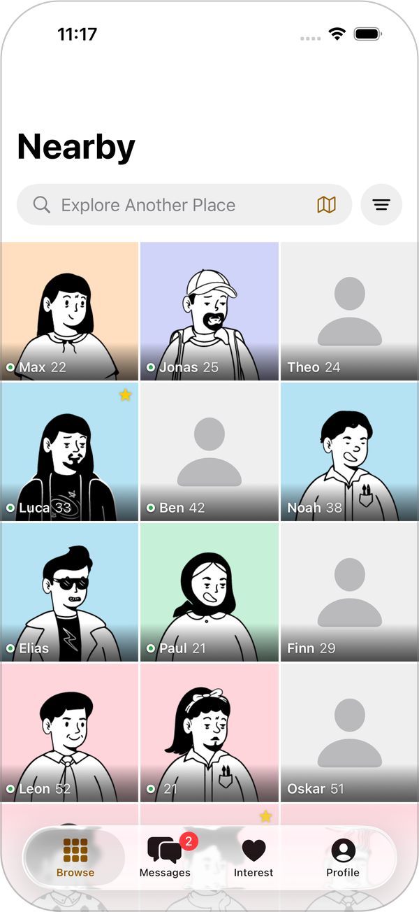
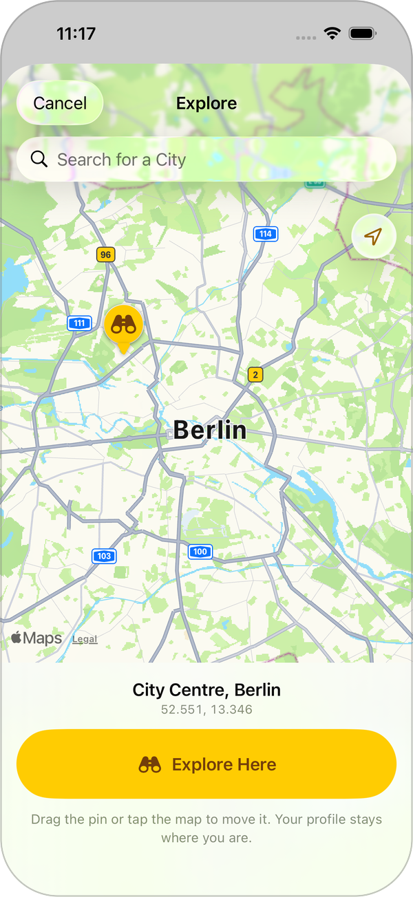
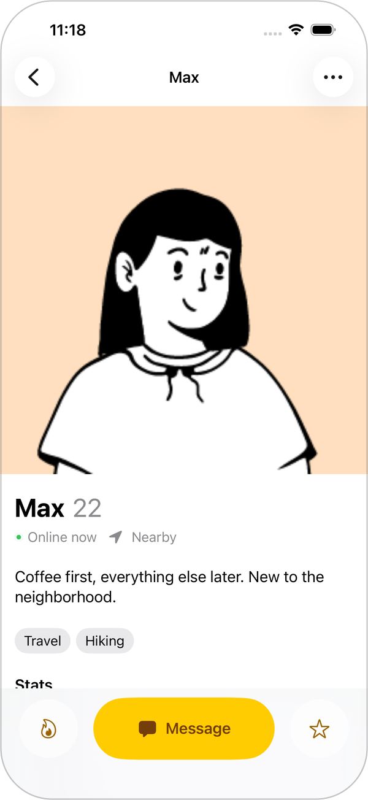
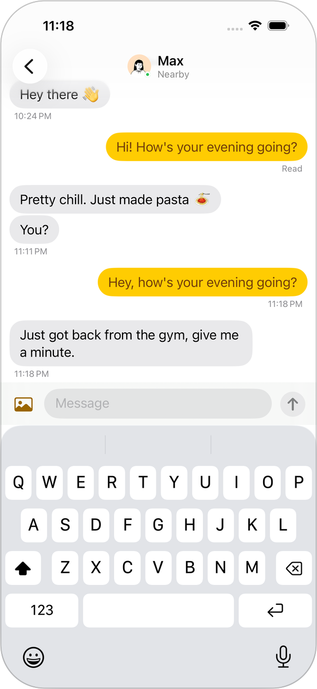
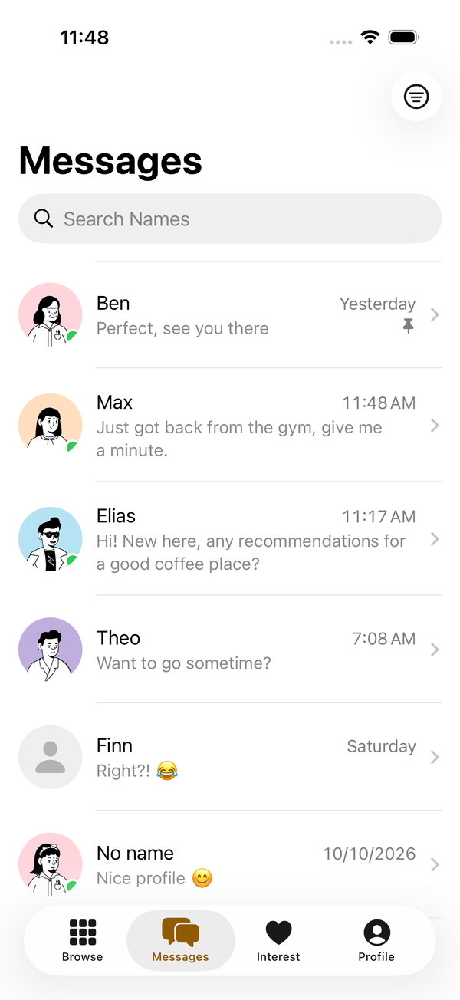
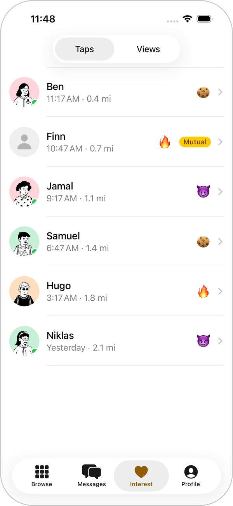
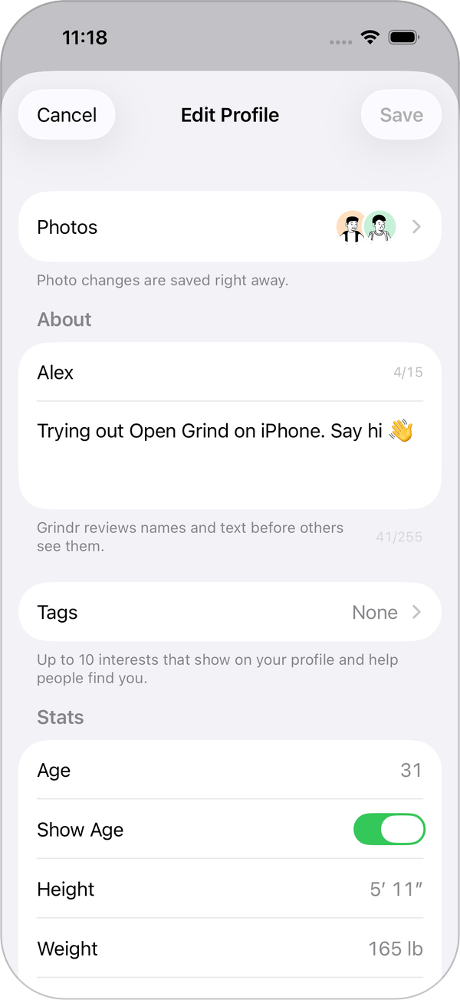
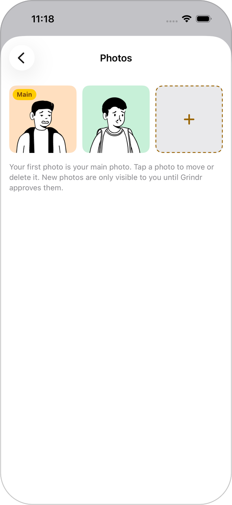
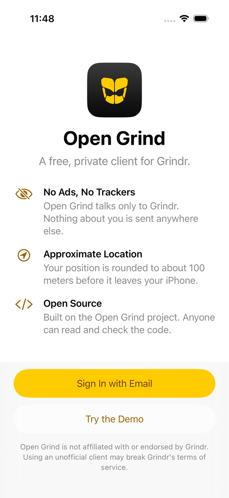

# Open Grind for iOS

A native SwiftUI port of [Open Grind](https://git.opengrind.org/open-grind/open-grind), the free
and open source Grindr client. No ads, no trackers: the app talks only to Grindr.

Not affiliated with, endorsed or sponsored by Grindr LLC. Using an unofficial client may break
Grindr's terms of service.

<table align="center">
  <tr>
    <td align="center" width="33%"><br><b>Nearby</b></td>
    <td align="center" width="33%"><br><b>Explore</b></td>
    <td align="center" width="33%"><br><b>Profiles</b></td>
  </tr>
  <tr>
    <td align="center" width="33%"><br><b>Chats</b></td>
    <td align="center" width="33%"><br><b>Messages</b></td>
    <td align="center" width="33%"><br><b>Interest</b></td>
  </tr>
  <tr>
    <td align="center" width="33%"><br><b>Edit Profile</b></td>
    <td align="center" width="33%"><br><b>Photos</b></td>
    <td align="center" width="33%"><br><b>Demo without an account</b></td>
  </tr>
</table>

<sub>Screenshots of the built-in demo on an iPhone 17 Pro simulator, taken by the UI tests on CI.
Everyone shown is made up; the avatars are DiceBear's Notionists by Zoish (CC0).</sub>

## Features

- **Browse**: the nearby grid with presence, favorites and unread counts; filters for age, height,
  weight, position, tribes, looking for, profile tags and more, the common ones as chips above the
  grid, remembered between launches; pull
  to refresh and endless scrolling. **Explore** another place by searching for a city or moving a
  pin on a map; your own profile stays where you are (moving it is Grindr's paid Roam, which the
  app doesn't do).
- **Profiles**: swipe sideways from one grid profile to the next and up and down through their
  photos, with a zoomable full-screen viewer; every profile detail, taps,
  favorites, and hide, block and report.
- **Messages**: the inbox with search, filters, pin, mute and delete; chats with live updates,
  typing and read indicators, photos, stickers, GIFs, locations, hearts, unsend and retry.
- **Interest**: taps and profile views.
- **Your profile**: edit every field Grindr allows, including gender, pronouns and up to 10 tags; add,
  reorder and delete photos (new ones are marked while Grindr reviews them); manage blocked profiles.
- **Appear anywhere**: turn on "Appear Here Too" on the Explore map, and Grindr sees you, your
  profile and your grid at that place instead of where you are, until you go back to your location;
  as upstream Open Grind's location picker does. No subscription, no GPS faking.
- **Demo**: try every screen with made-up profiles, without an account.

Built to Apple's Human Interface Guidelines: system navigation, tab bar and sheets; Dynamic Type,
VoiceOver labels and actions, Reduce Motion and dark mode; Liquid Glass on iOS 26, iOS 18 and later.

### Sign-in

Only email and password. Other methods were looked into:

- **Apple**: not possible. Grindr's API has no Apple sign-in, and Apple identity tokens are bound
  to the app that requested them, so Grindr would never accept one issued to Open Grind.
- **Phone number**: Grindr has `POST /v4/sms/sessions`, but its request is undocumented and
  `grindr.rs` cannot refresh phone sessions. Possible once both are worked out upstream.
- **Google and Facebook**: `grindr.rs` can sign in with a provider token, but Grindr only accepts
  tokens issued to its own Google and Facebook apps. Upstream gets one through an Android-only
  companion app or a pasted token; on iOS the only smooth way would be to pose as Grindr's app,
  which Open Grind doesn't do.

## Privacy

- Your location is rounded to a 0.001° grid (about 100 m) before it is sent. With a place chosen
  to appear at, the app sends that place and never asks the device where it is.
- Every sign-out gives the app a new device identity, so the next sign-in can't be linked to it.
- The session token is kept in the Keychain (this device only); your password is never stored.
- Photos you send or upload are re-encoded, which removes EXIF data such as where they were taken.
- While you explore, the grid sends the explored place instead of your location, rounded the same
  way; place search and names come from Apple Maps.
- Photos are cached for a week (at most 200 MB) and removed when you sign out. No analytics, no crash reporting.

## How it works

Grindr's servers reject clients whose TLS and HTTP/2 fingerprints differ from the official app's.
The upstream project solved that with [`grindr.rs`](https://git.opengrind.org/open-grind/grindr.rs),
a Rust client that emulates the Android app. This port reuses it:

| Part | What it is |
|---|---|
| `core/` | Rust crate `opengrind-core`: wraps the `grindr` crate in a small [UniFFI](https://mozilla.github.io/uniffi-rs/) interface (requests, media, websocket, sign-in). |
| `OpenGrindKit/` | Swift package. `OpenGrindKit`: models, API, realtime events and `@Observable` state for every screen, plus a demo transport. `OpenGrindCoreTransport`: the transport on top of the Rust bridge. |
| `OpenGrind/` | The SwiftUI app. |
| `OpenGrindTests/`, `OpenGrindUITests/` | App unit tests and a UI test that walks through the demo and keeps screenshots. |

## Building

You need Xcode 26 and [Nix](https://nixos.org/download/). The flake's shell provides Rust with the
iOS targets, cmake and perl, so nothing else has to be installed; Xcode only sees the finished
framework:

```sh
nix develop -c scripts/build-core-xcframework.sh   # builds OpenGrindKit/Frameworks/opengrind_coreFFI.xcframework
open OpenGrind.xcodeproj
```

Without Nix, install Rust with `rustup target add aarch64-apple-ios aarch64-apple-ios-sim
aarch64-apple-darwin` and cmake, then run the script directly. Run it again after changing `core/`.

Pick your team under Signing & Capabilities to run it on a device. Start with **Try the Demo** to
explore without an account, or pass `-demoMode YES` as a launch argument.

### Without a Mac

The Nix flake builds the Rust bridge and the Swift package on Linux and runs their tests, checks
that the committed UniFFI bindings are current, and parses and lints the app:

```sh
nix build            # OpenGrindKit, with its tests
nix flake check      # all of the above
nix develop          # Swift, swift-format and Rust toolchains
```

[Hydra](https://hydra.kyouma.net/jobset/open-grind-ios/main) builds these checks on every push to `main`.
GitHub Actions builds the app for iPhone, runs the unit and UI tests on a simulator and uploads
the screenshots of the demo tour as an artifact.

### Regenerating the bindings

After changing the UniFFI interface in `core/src/lib.rs`:

```sh
nix build .#core
cp result/share/swift/opengrind_core.swift OpenGrindKit/Sources/OpenGrindCore/
cp result/share/swift/opengrind_coreFFI.h OpenGrindKit/Sources/opengrind_coreFFI/include/
```

## License

MIT, see [LICENSE](LICENSE). Based on Open Grind (MIT); the logo is CC0.
